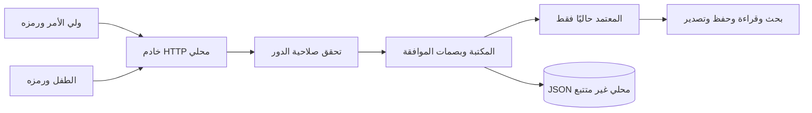
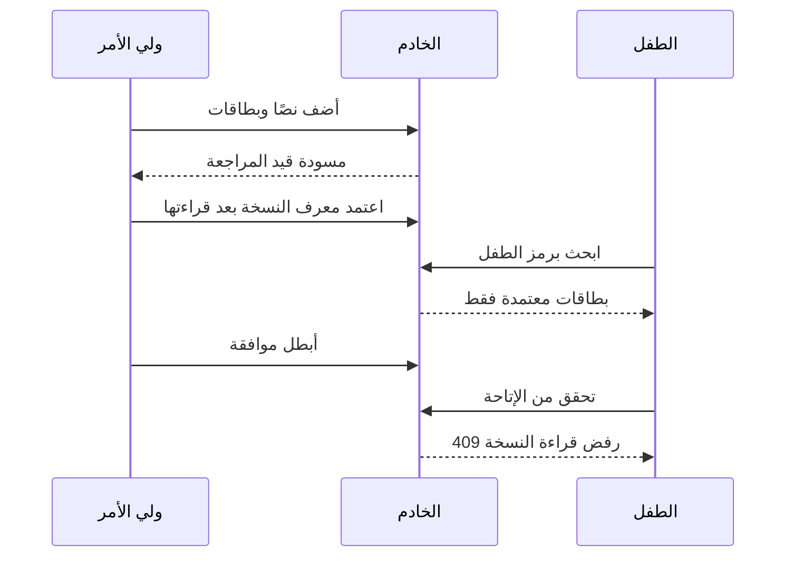
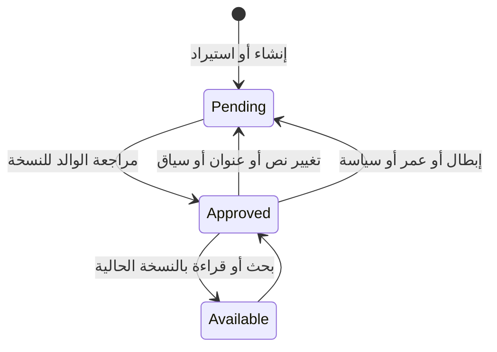
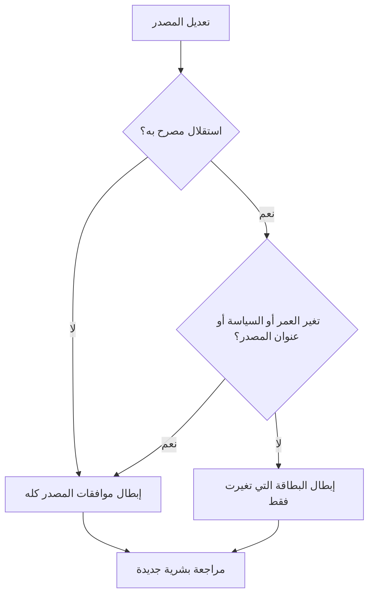
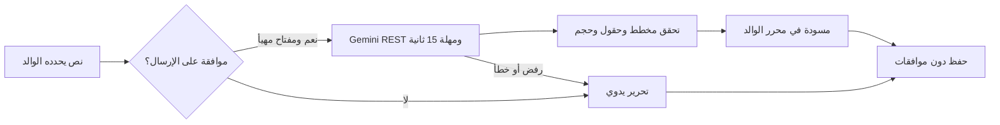
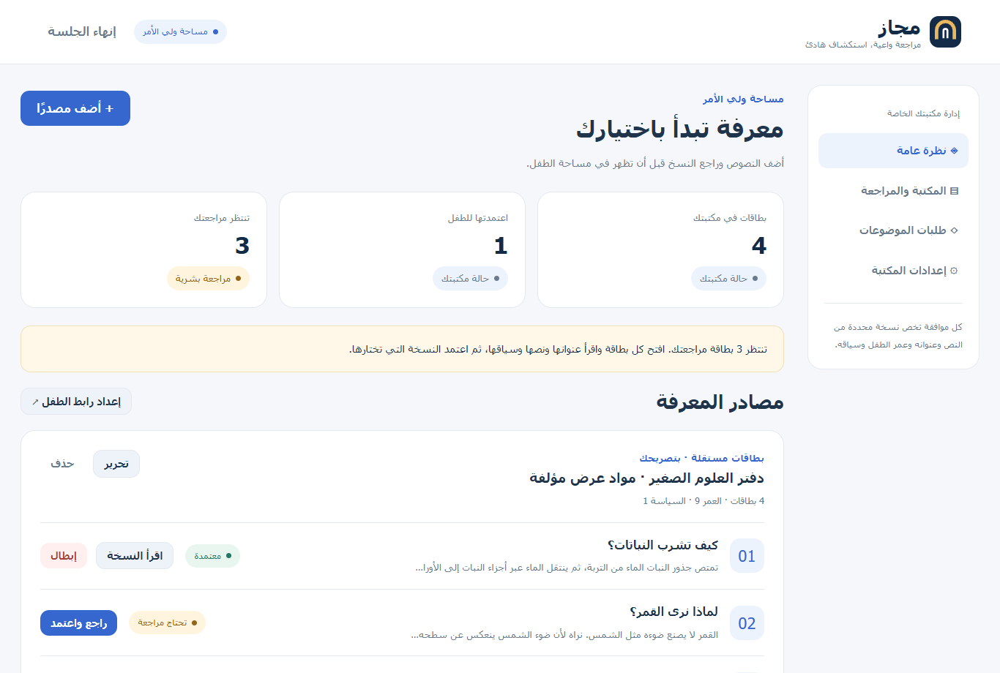
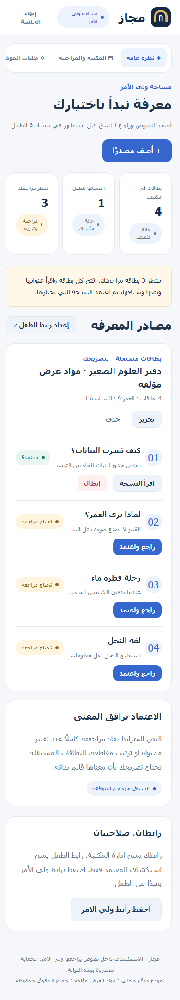

# مجاز

مكتبة عربية خاصة للاستكشاف التعليمي: يضيف ولي الأمر النصوص ويقرأ عناوين البطاقات ونصوصها وسياقها ويعتمدها لعمر طفله، ثم يبحث الطفل ويقرأ ويحفظ من المعتمد حاليًا فقط. مواد العرض مؤلفة وليست بيانات استخدام فعلية. القرار البشري بالموافقة لا يثبت أن المحتوى مناسب لكل الأطفال.

## المشكلة والتقييم والاستدامة المقترحة

يربط دليل الجائزة (ص16) التحدي بالتعرض لمحتوى غير مناسب وضعف المرافقة الأسرية. قد يستمر الطفل بدافع الفضول دون بلاغ، واعتماد مادة مرة لا يثبت اعتمادها بعد تغير النص أو السياق. يتيح مجاز مراجعة الوالد قبل الإتاحة داخل بوابة نصية محددة؛ ملاءمتها للأسر وعبء المراجعة يحتاجان تجربة لاحقة.

المستهدف: عدد أخطاء إتاحة غير المعتمد في سيناريوهات الاختبار، ودقائق مراجعة الوالد لإضافة أو تحديث، ونسبة طلبات الطفل التي وفّر لها مادة معتمدة من جميع الطلبات. الأول تقني والآخران لتجربة أسرية لاحقة بموافقة. لا تجربة أطفال أو إثبات ملاءمة لكل الأعمار أو حماية خارج البوابة.

استدامة مقترحة: مكتبة قابلة للتصدير والاستيراد، وصيانة موثقة دون API إلزامي. يُدرس إعداد حزم تعليمية بعد مراجعة مختصة وتجربة عبء الاستخدام. يبقى الاعتماد للوالد، والنشر يحتاج استضافة وحماية؛ لا تمويل سابق.

الواجهة عربية RTL وفُحص عرض 390 بكسل. دعم لوحة المفاتيح وقارئ الشاشة يحتاج تقييمًا إضافيًا؛ لا ادعاء توافق معياري.

## التشغيل

تحتاج Node.js 22 أو أحدث وnpm. لا تحتاج إلى تثبيت أي حزم، ولا مفتاح ذكاء اصطناعي.

```sh
npm start
# افتح http://127.0.0.1:3173
npm test
npm run build
npm run verify
```

الخادم مرتبط بـ127.0.0.1؛ لا يُتاح لجهاز طفل آخر على الشبكة في هذا النموذج. تستخدم تجربة العرض نافذتين مستقلتين على الجهاز نفسه. ناتج البناء في `dist/`، ويمكن تشغيل `node dist/server.mjs` منه؛ أمر البناء يفحص بنية JavaScript وينسخ ملفات الموقع والاختبارات والوثائق فقط. ملفات البيانات والمفاتيح لا تُحزم. أوامر الاختبار تعتمد HTTP محليًا؛ بيئات الرمل التي تمنع TCP المحلي تحتاج السماح بتشغيل الاختبار المحلي. لا توجد عملية npm install.

## رحلة ولي الأمر والطفل

1. اختر «ابدأ مكتبتك» أو «جرّب مكتبة العرض». يحتوي العرض أربع بطاقات تعليمية مؤلفة، وجميعها غير معتمدة في البداية. احفظ رابط ولي الأمر من النظرة العامة أو الإعدادات؛ من يملك الرابط يملك الصلاحية.
2. أضف مصدرًا بعنوان وبطاقات. الحد 20 بطاقة و20000 حرف إجماليًا لكل مصدر، و50 مصدرًا للمكتبة. النص المترابط افتراضي؛ الاستقلال يتطلب تصريحك بأن كل بطاقة قائمة بذاتها. لا تُجلب روابط أو مقاطع فيديو.
3. اضغط «راجع واعتمد» لكل بطاقة. اقرأ العنوان والنص والسياق وأكّد المراجعة للعمر والسياسة. لا توجد موافقة جماعية تلقائية. يرسل الاعتماد بصمة المحتوى الذي راجعه الوالد؛ إذا تغيّر النص أو السياق قبل إرساله يرفض الخادم المراجعة القديمة. مصدر العرض يصرح باستقلال بطاقاته المؤلفة؛ المصدر الذي تضيفه يبدأ مترابطًا.
4. افتح رابط الطفل في نافذة مستقلة. ابحث مثلًا عن «النباتات»، وافتح البطاقة واحفظها. البحث والتصدير والحفظ لا يرسلون أي بطاقة غير معتمدة من الخادم.
5. أرسل موضوعًا من مساحة الطفل مع تأكيد إرساله إلى ولي الأمر. يظهر طلبًا في قائمته؛ لا يولّد إجابة أو يجلب محتوى خارجيًا. مراجعة الطلب لا تعني تلبية الموضوع.
6. عدّل نص البطاقة أو عنوانها. يعرض مربع المراجعة النسخة السابقة والحالية. النص المترابط يحتاج موافقة جديدة لكل بطاقاته؛ في الاستقلال المصرّح به تبقى موافقات البطاقات الأخرى ما لم يتغير عنوان المصدر أو العمر أو السياسة.
7. أبطل موافقة بطاقة بينما صفحة الطفل مفتوحة. تُرفض فورًا في API وتختفي من الحفظ والتصدير والقراءة، ثم يحجبها المتصفح عند فحصه التالي (كل 5 ثوانٍ أثناء عمل المؤقت؛ قد يؤخر المتصفح المؤقت بالخلفية). عند انقطاع الاتصال يتوقف العرض بعد محاولة التحقق الفاشلة. لا يمكن استرداد معلومات سبق قراءتها أو تصويرها أو تصديرها.
8. صدّر المكتبة واستوردها من الإعدادات. يضيف الاستيراد نصوصًا للمراجعة فقط، ولا يستورد الموافقات أو رموز الدخول أو العمر والسياسة من الملف. تغيير العمر أو السياسة عبر الإعدادات يبطل الجميع.

البيانات في `data/libraries.json` وتتجاهلها Git. الرموز العشوائية تُحفظ تجزئاتها فقط على الخادم؛ المتصفح يحفظ رمز الدور في sessionStorage للنافذة. يحتاج دخول الطفل نافذة مستقلة دون جلسة ولي الأمر. لا تسجل الخوادم النصوص أو رموز الدخول. رابط الطفل قابل للتجديد، ويصبح السابق مرفوضًا. لا توجد خدمة استعادة لرابط ولي الأمر المفقود. النسخ الاحتياطية والتصدير مسؤولية صاحب المكتبة. لا يوفر ملف JSON المحلي تشفيرًا عند التخزين أو هوية موثقة أو أمان جهاز مشترك؛ اختراق حساب نظام التشغيل أو مشاركة جلسة الوالد يخرجان عن حدود صلاحيات الموقع.

## كيف تمنع الآلية التسرب؟

بصمة الموافقة SHA-256 تشمل عنوان البطاقة ونصها وعنوان المصدر ونمطه وتصريح استقلاله والعمر والسياسة. للمصدر المترابط تشمل البصمة محتوى وترتيب جميع بطاقاته. لا تُرسل هذه البصمة للطفل. تعطي كل نسخة معرفًا عشوائيًا منفصلًا، ويجب تقديم النسخة الصحيحة عند القراءة والحفظ والاعتماد؛ تغير الموافقة أو النسخة يرفض القراءة أو الاعتماد برمز 409. لا يتجاوز رمز الطفل صلاحياته بتغيير قيمة role في الواجهة. المسارات غير المصرح بها ترفض برمز 403.

الخادم يكوّن البيانات من `allowed()` قبل البحث والتصدير، فلا تصل العناوين أو المقتطفات أو الحقول الخاصة أو عدد البطاقات غير المعتمدة. عدم التطابق يعيد `{ "cards": [] }` فقط. تطبيع البحث العربي يزيل التشكيل والتطويل ويوحّد أشكال الألف والياء المقصورة. الواجهة تُنشئ النص بعقد DOM نصية؛ HTML المضاف لا يُنفذ. سياسة CSP تمنع scripts وiframes والمصادر الخارجية؛ كل كتابة تتطلب Origin مطابقًا وapplication/json وحد حجم. لا يوجد أي مسار لجلب URL يختاره المستخدم.

## Gemini الاختياري

المساعد يكتب مسودة لولي الأمر من نص يختار إرساله إلى Google Gemini ويؤكد الموافقة على إرساله. لا يقرر سلامة النص، ولا يعتمد بطاقة، ولا يجري محادثة حرة مع الطفل. متغيرا البيئة الخادميان `GEMINI_API_KEY` و`GEMINI_MODEL`؛ `.env.example` يحوي placeholder فقط. لا يُحمّل `.env` تلقائيًا؛ ضع المتغيرات في بيئة التشغيل أو استعمل `node --env-file=.env server.mjs` مع ملفك الخاص غير المتتبع. النموذج الافتراضي `gemini-3.5-flash-lite` موثق في [قائمة Google الرسمية](https://ai.google.dev/gemini-api/docs/models) التي روجعت في 8 أكتوبر 2026. يستخدم REST `generateContent` مع `responseJsonSchema` وفق [وثائق البنية المنظمة](https://ai.google.dev/gemini-api/docs/structured-output)، ومهلة 15 ثانية وتحقق محلي صارم من الحقول والأحجام.

لا يوجد مفتاح مقدم في هذه التجربة: لم يُختبر اتصال Gemini حي. اختبارات المهايئ تحاكي طبقة HTTP فقط بشكل معلن وتختبر معالجة البنية غير الصالحة ورفض السلامة والانقطاع والمهلة. قد يتطلب حساب Google صلاحيات أو تكلفة أو إعدادات إضافية. يظل المسار اليدوي كاملًا.

## الاختبارات والأدلة

`test/core.test.mjs`: حالات مستقلة للتسرب والسياق والاستقلال والعمر والسياسة والترتيب والاستيراد والنسخة القديمة. `test/http.test.mjs`: طلبات خادم حقيقية للأدوار المزورة، وفحص serialization الكامل، وOrigin/content type، ومعاملة XSS نصًا، وإبطال بطاقة محفوظة وطلب الموضوع. `test/gemini.test.mjs`: اختبار مهايئ API بطبقة HTTP محاكاة معلنة. انظر [تقرير التنفيذ](docs/implementation-report.md) وملفات الأدلة.

أداة المتصفح الاختيارية `scripts/browser-qa.mjs` تستخدم Playwright الذي توفره بيئة العمل، وهو ليس اعتماد تشغيل للموقع. مساره قابل للتغيير عبر PLAYWRIGHT_MODULE. تختبر اعتمادًا يدويًا، وقراءة الطفل وإبطالها وطلب الموضوع ومراجعة فرق النسخة وعرض 390px. الصور الفعلية في `docs/screenshots/`.

## البدائل والفرق المحدود

| البديل | ما يقدمه المصدر الرسمي | الفرق المحدود في مجاز |
|---|---|---|
| [YouTube Kids: Approved content only](https://support.google.com/youtubekids/answer/6172308) | اختيار الوالد فيديوهات وقنوات ومجموعات محددة | مجاز نصوص يضيفها الوالد، واعتماد على مستوى بطاقة مرتبطة بسياق وعمر وسياسة. لا يدعم فيديوهات. |
| [Sprout Browser](https://sproutbrowser.com/safety) | متصفح للأطفال وتصفح من اختيارات يضبطها الوالد | مجاز مكتبة نصية مغلقة بخادم يرسل البطاقات المعتمدة فقط. لا يفلتر التصفح العام. |
| PDF أو مستند خاص | نسخ مختارة بسيطة قابلة للقراءة والمشاركة | قد يكون المستند كافيًا. يضيف مجاز بحثًا داخل المعتمد وإبطال موافقات مرتبطًا بالنسخة والسياق. |
| [SingleFile](https://github.com/gildas-lormeau/SingleFile) | حفظ صفحة ويب كاملة في ملف HTML مستقل | بديل للأرشفة المحلية؛ مجاز لا يحفظ الويب، ويطبق مراجعة بطاقات نصية وخادم صلاحيات. |

هذه مقارنة مستندات منتجات، وليست اختبارًا ميدانيًا أو إثباتًا لغياب الميزات عند البدائل أو جدة مطلقة. الفرق المقترح يحتاج اختبار سهولة استخدام؛ كلفة مراجعة الوالد قد تجعل مستندًا بسيطًا أفضل في حالات كثيرة. لا ادعاء أثر اجتماعي مثبت أو ملاءمة لكل الأعمار، ولا نسب حماية أو ثقة مصطنعة. مقترح تقييم لاحق: قياس زمن مراجعة مصدر، وعدد أخطاء الموافقة أثناء تعديله، وفهم الوالد لحدود النطاق؛ لا أطفال فعليون أو استبيانات أرسلت في هذه النسخة.

## المعمارية والمخططات











ثلاثة مخططات SVG مستقلة: [المعمارية](docs/diagrams/architecture.svg)، [المراجعة](docs/diagrams/approval.svg)، [أثر السياق](docs/diagrams/context.svg). جميع الحقوق محفوظة وفق [بيان الحقوق](RIGHTS.md). المستودع لا يتضمن بيانات الاتصال بالمشارك أو وثائق المشاركة الخاصة.

## صور النسخة المنفذة والتحقق النهائي





تحقق المنسق من 21 اختبارًا ناجحًا دون احتساب نسخ dist، ومن رحلة المتصفح والتصدير والعرض بعرض 390px دون أخطاء JavaScript أو تجاوز أفقي. الأدلة في `docs/coordinator-final-tests.txt` و`docs/coordinator-browser-qa.json`. حالات التجربة مؤلفة ولا تمثل أثرًا اجتماعيًا مقاسًا.
